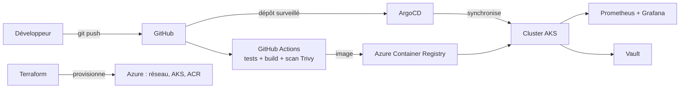

# azure-gitops-pipeline : chaîne CI/CD cloud-native (AcadConf)

> **Statut : projet en cours.** La partie CI (tests, image Docker, scan de sécurité) est opérationnelle. La partie Azure / Kubernetes / GitOps est en cours de réalisation : voir la feuille de route.

Objectif : bâtir une chaîne de livraison complète autour d'une application Java, de l'infrastructure décrite en code jusqu'au déploiement piloté par Git sur Kubernetes (AKS), avec supervision et gestion des secrets.

L'application déployée, **AcadConf** (gestion de conférences académiques), est volontairement un support : **le sujet du projet est la chaîne de livraison, pas l'application.**

## Ce qui est en place

| Élément | Détail |
|---|---|
| Application | AcadConf : Spring Boot 3.5, Java 21, MySQL 8 (dossier `app/`) |
| Image Docker | Build multi-étapes (Maven puis JRE Alpine), exécution avec un utilisateur non-root |
| CI (GitHub Actions) | À chaque push sur `main` et chaque pull request : tests Maven avec une base MySQL 8, puis build de l'image Docker |
| Sécurité | Scan **Trivy** de l'image : le pipeline échoue en cas de vulnérabilité HIGH ou CRITICAL |
| Supervision | Endpoint de métriques Prometheus exposé par l'application (`/actuator/prometheus`) |

## Feuille de route

- [x] Application conteneurisée (Dockerfile multi-étapes, utilisateur non-root)
- [x] CI : tests Maven avec MySQL, build de l'image Docker
- [x] Scan de vulnérabilités Trivy bloquant (HIGH / CRITICAL)
- [x] Métriques Prometheus exposées par l'application
- [ ] Infrastructure Azure avec Terraform : Resource Group, réseau, AKS, Azure Container Registry
- [ ] Publication de l'image vers ACR depuis la CI
- [ ] Chart Helm de l'application
- [ ] Déploiement GitOps avec ArgoCD
- [ ] Observabilité : kube-prometheus-stack (Prometheus + Grafana)
- [ ] Secrets avec HashiCorp Vault
- [ ] Ingress NGINX, TLS (cert-manager) et NetworkPolicy
- [ ] Documentation finale : schéma d'architecture, captures, `terraform destroy` documenté

## Architecture cible



*Schéma de la cible : les composants non cochés ci-dessus ne sont pas encore réalisés.*

## Lancer l'application en local

Prérequis : Java 21, Maven, une base MySQL 8.

```bash
cd app
export MYSQLHOST=localhost MYSQLPORT=3306 MYSQLDATABASE=acadconf
export MYSQLUSER=root MYSQLPASSWORD=<votre_mot_de_passe>
mvn spring-boot:run
```

Avec Docker :

```bash
docker build -t acadconf app
```

## Documentation de l'application

- `app/DEVOPS_MAP.md` : carte DevOps / infrastructure d'AcadConf (configuration, variables d'environnement, stockage)
- `app/ACADCONF_GUIDE.md` : fonctionnement interne du code

## Auteur

**Hamza Balla** : étudiant ingénieur à l'INSEA (Data and Software Engineering), à la recherche d'un stage PFE en DevOps / Cloud.
